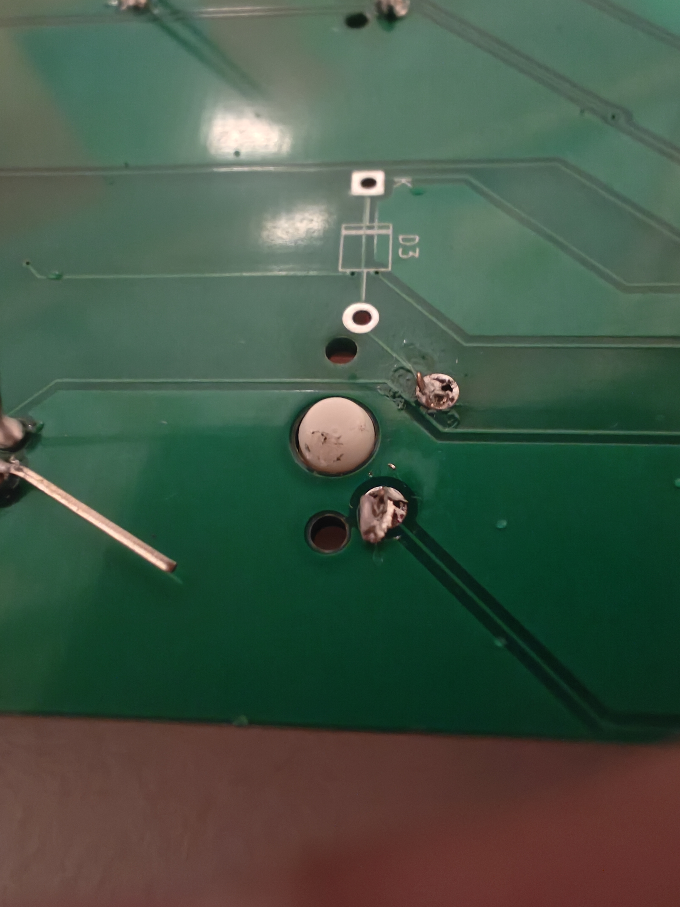
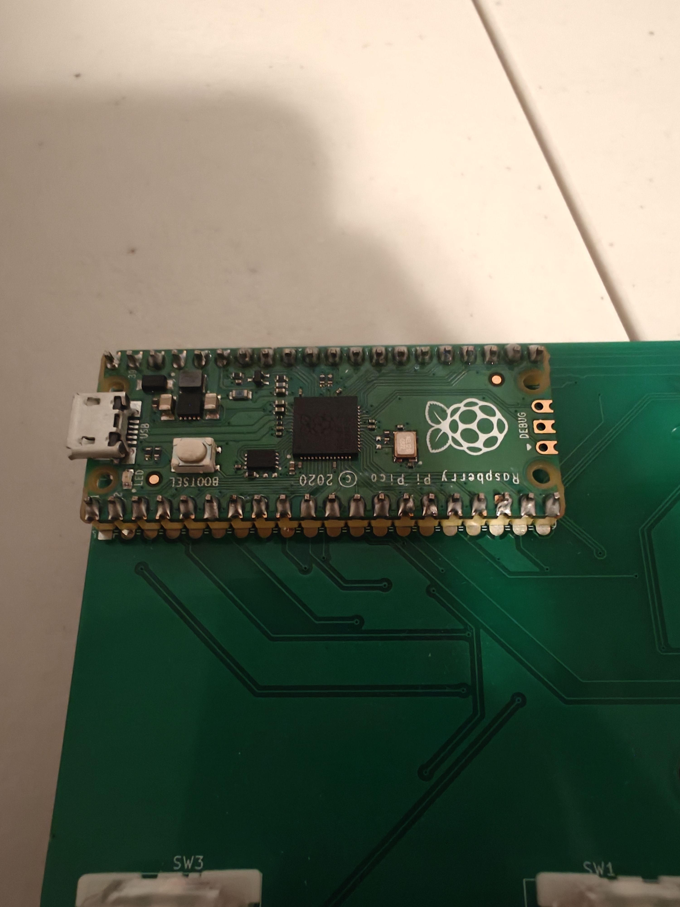

# September 2: Sodered some of the basic components.

This devlog I worked on trying to soder all the components onto the pcb. This is my first time sodering so it did not go the best. I partially burnt one of the key switches, oops. . The resistors were very messy as well with the the footprint being too small to actually fit the resistor properly. The other than this I feel like my sodering on the raspberry pi pico was good enough that . Overall, this is not too bad. I really need to be more efficient in my time though.

-Recording links
https://lapse.hackclub.com/timelapse/0V47lkOwijM5
https://lapse.hackclub.com/timelapse/Xaw-gElLUrd_
https://lapse.hackclub.com/timelapse/J6UoXvX0RNCo
https://lapse.hackclub.com/timelapse/zv9pdq6mI1ch
https://lapse.hackclub.com/timelapse/Xwd5ic2uPJUL

**Total time spent: 1.56 hours**

# Nov 7: Messed up the buttons but I got the pcb assembly done.

Uhh, I found out about an incredibly embarrising mistake. I forgot how buttons are supposed to work. I forgot that when a keyswitch goes down the extra space of the button has to go somewhere. I also soldered the buttons down in a slightly different orintation that I intened. I plan on having what is basically a normal keycap on one side and a bar to hold the 2 down. I also got alot of the diodes soldered onto the keyboard. I also found a very sily mistake, Some of my footprints are overlapping each other. Electically, it doesn't matter that much since they would be connected anyways however physically, it does matter alot. But also the PCB assembly is done, I am pretty happy about that. I need to make the bottom case taller to account for the fact that I do not own one of those  fancy flush cut wire clippers. I also need to chagne the firmware to account for the fact that the footprint that I chose for the PC150 does not fit properly. I should still be fine it is just that it will basically be a macropad but through the webui thing I should be able to do it. I also noticed an error with the way I originally designed the PCB. One of the footprints for the keyswitch and one for the diode were mashed together in something kinda annoying. . It is mostly fine I think just because those are supposed to be connected anyways. I need to get the linkage bar thing working next. The next steps are mostly CAD.

-Recording Links
https://lapse.hackclub.com/timelapse/sZxf5_8vFWl5
https://lapse.hackclub.com/timelapse/Arb5aq1DIcCP
https://lapse.hackclub.com/timelapse/HOAYPzRP_kXY
https://lapse.hackclub.com/timelapse/R-7RvlI27MGb

**Total Time Spent: 0.88 hours** 